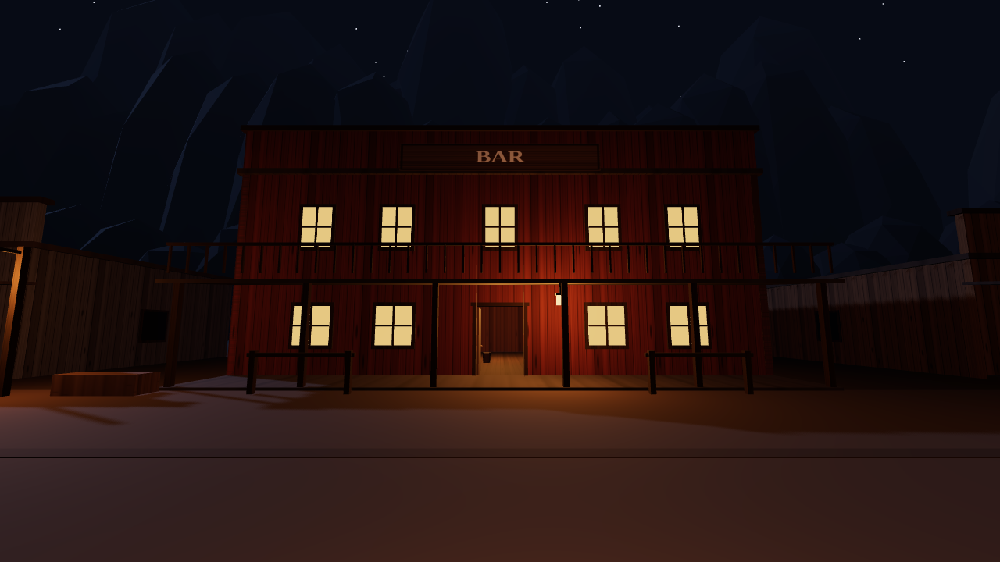
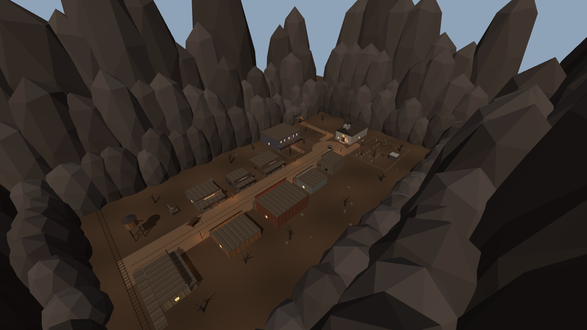

# Amigos do Rui (nome provisório)

Jogo de terror e mistério para 3 a 6 amigos. Cada partida sorteia uma história nova dentro da mesma cidade de faroeste sombrio, e a história decide quais lugares estão abertos naquela noite.

**Estado atual: só o cenário.** Dá para andar pela cidade em primeira pessoa, entrar nos lugares abertos e sortear outras noites. Ainda não existe jogabilidade, história nem multiplayer.


| | |
| --- | --- |
|  |  |
|  |  |

## Como rodar

Precisa de Node 22 ou mais novo.

```bash
npm install
npm run dev
```

Abra o endereço que aparecer no terminal (normalmente http://localhost:5173) e clique para entrar.

| Tecla | O que faz |
| --- | --- |
| WASD ou setas | andar |
| Mouse | olhar |
| Shift | correr |
| F | acender ou apagar o lampião |
| M | abrir o mapa |
| R | sortear outra noite |
| Esc | soltar o mouse |

### Parâmetros de URL

| Parâmetro | Exemplo | Para que serve |
| --- | --- | --- |
| `seed` | `?seed=7` | repete sempre a mesma noite |
| `abertos` | `?abertos=bar,mina` | força quais lugares estão abertos (vazio fecha todos) |
| `dia` | `?dia=1` | luz de dia e sem neblina, para inspecionar a geometria |
| `hud` | `?hud=0` | esconde a interface |
| `exposicao` | `?exposicao=1.6` | clareia ou escurece a imagem (padrão 1.3) |
| `cam` | `?cam=0,26,-70,3.14,-0.42` | prende a câmera em x, y, z, giro, inclinação |

## A cidade

Nove lugares podem abrir ou fechar a cada noite: Estação, Armazém, Bar, Banco, Delegacia, Casarão, Igreja, Cemitério e Mina. Cinco abrem por noite. Lugar aberto tem porta aberta, janelas acesas e lampião. Lugar fechado tem porta e janelas pregadas com tábuas. Funerária, Ferraria e Pensão só compõem a rua e nunca abrem.

A planta inteira está em dados em `src/mundo/planta.ts`. O mapa do jogo, a colisão e os testes saem todos dali.

## Conferência automática

```bash
npm run conferir   # tipos + testes da planta
npm run colisao    # anda pela cidade num Chrome sem janela e confere portas e caminhos
npm run capturas   # tira capturas de tela de 18 pontos da cidade, na pasta capturas/
npm run planta     # regenera docs/planta.svg e docs/planta.png
```

`colisao` e `capturas` precisam do Google Chrome instalado. Se ele não estiver em `/usr/bin/google-chrome`, aponte o caminho na variável `CHROME`. No Windows, por exemplo:

```powershell
$env:CHROME = "C:\Program Files\Google\Chrome\Application\chrome.exe"; npm run capturas
```

## Estrutura

```
index.html              página e interface (HUD, mapa, tela de entrada)
src/main.ts             cria a cena, monta a noite, laço principal
src/jogador/jogador.ts  câmera em primeira pessoa e colisão
src/mundo/planta.ts     planta da cidade em dados puros
src/mundo/noite.ts      sorteio dos lugares abertos
src/mundo/base.ts       materiais, texturas e formas básicas
src/mundo/predios.ts    prédios, interiores, igreja, mina e cemitério
src/mundo/cenario.ts    chão, paredão, céu, lua e adereços
src/mundo/cidade.ts     junta tudo e calcula as caixas de colisão
src/mundo/plantaSvg.ts  desenha o mapa
src/nucleo/rng.ts       gerador de números com semente
scripts/                capturas, colisão e planta
test/                   testes da planta e do sorteio
```

## Próximos passos

1. Você andar pela cidade e dizer o que mudar: escala, distâncias, clima, lugares.
2. Jogabilidade solo: regras, fragmentos de história e cenas disparadas ao entrar nos lugares.
3. Multiplayer: servidor, salas, votos e os outros jogadores visíveis na cidade.

O documento de conceito do jogo tem o desenho completo. As convenções para quem for mexer no código estão em `CLAUDE.md`.
