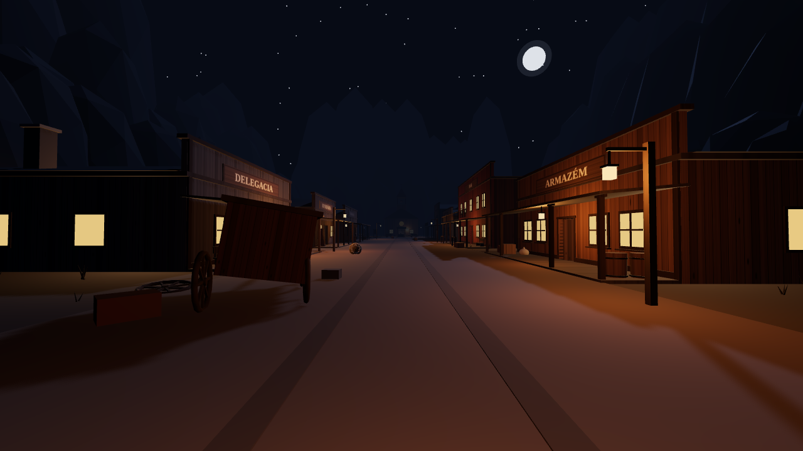
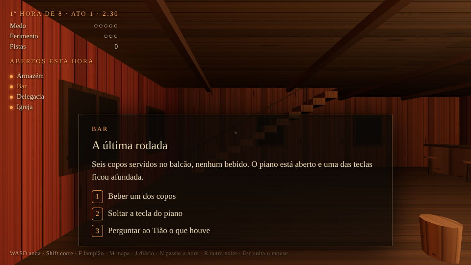
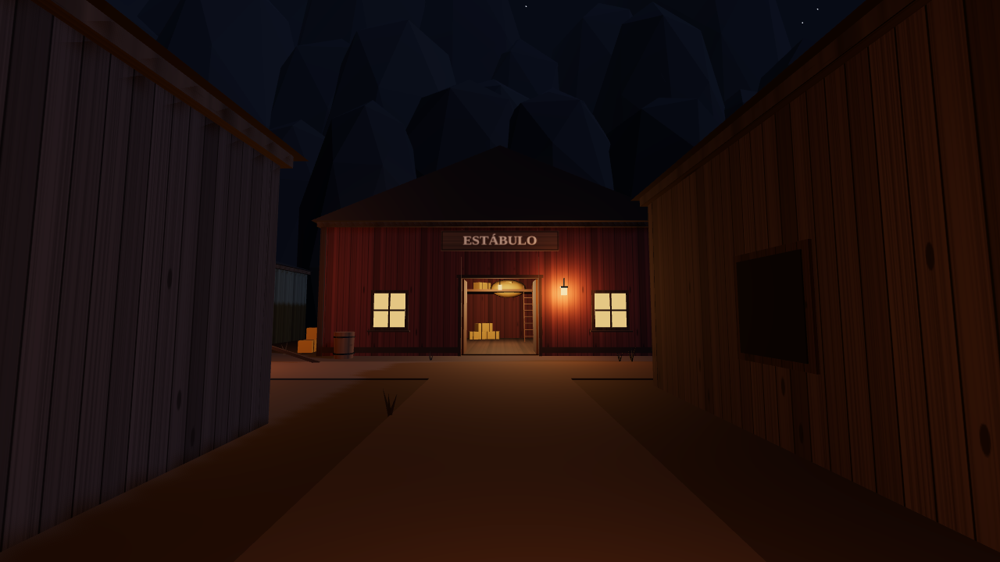
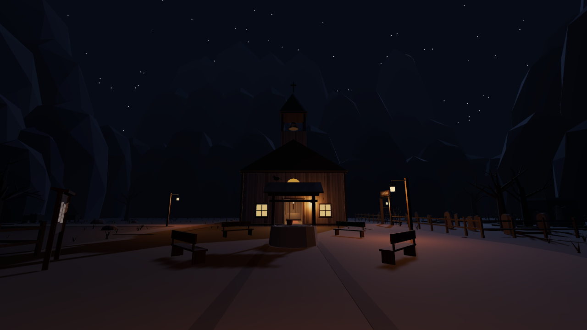
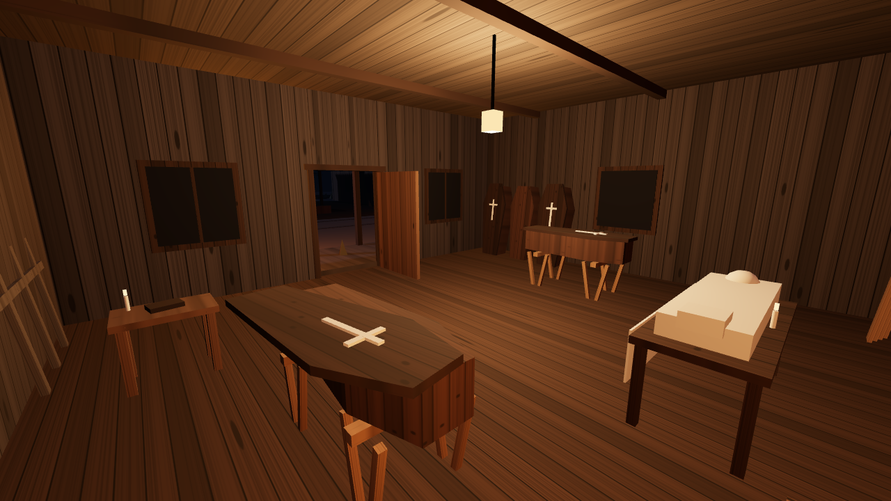
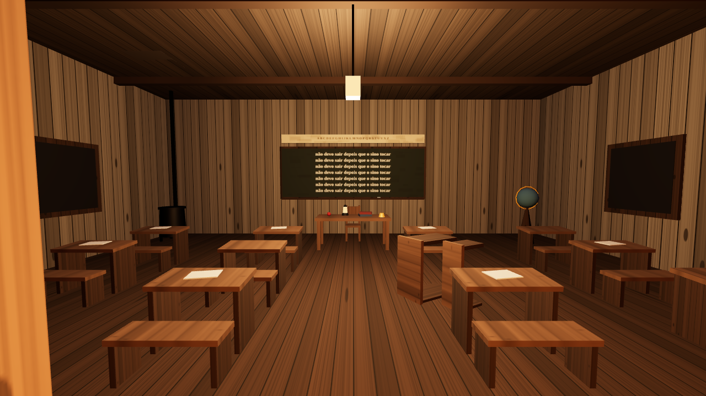
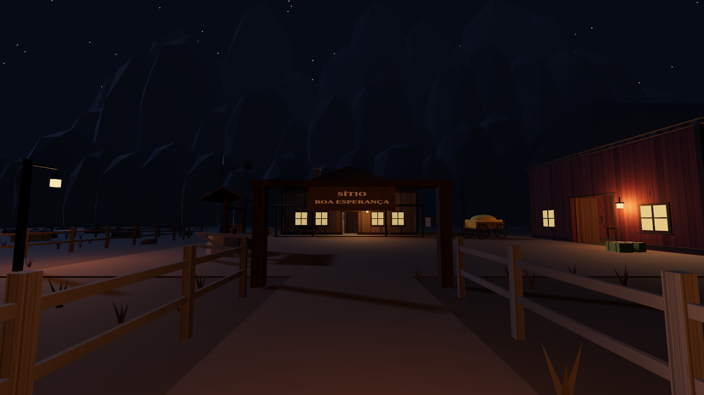
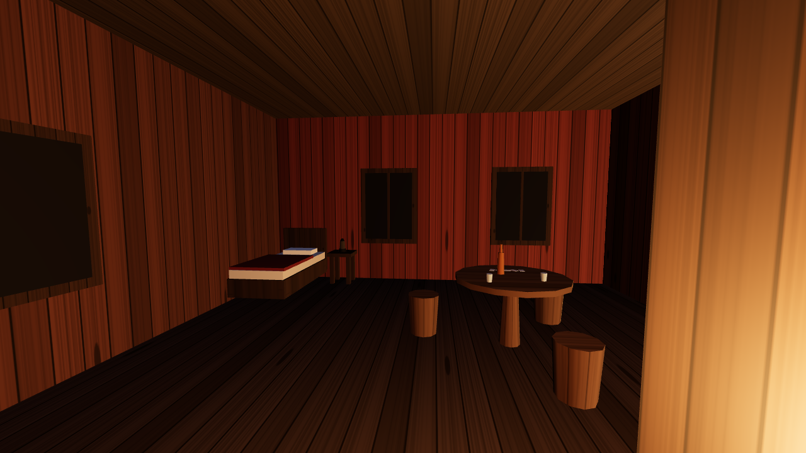
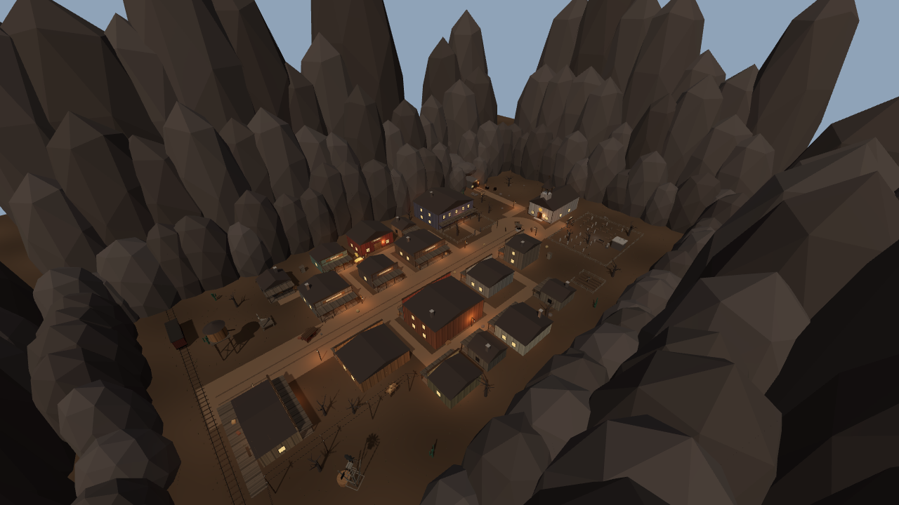
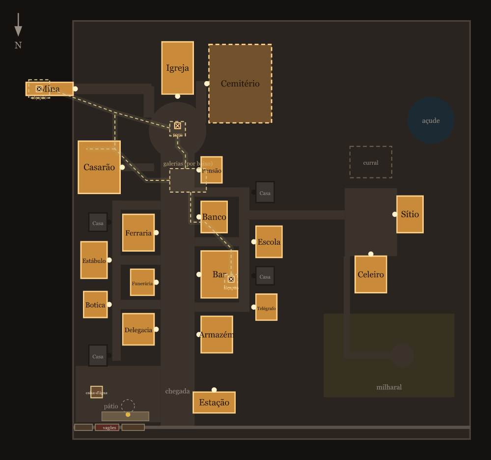

# Amigos do Rui (nome provisório)

Jogo de terror e mistério para 3 a 6 amigos. Cada partida sorteia uma história nova dentro da mesma cidade de faroeste sombrio, e a história decide quais lugares estão abertos naquela noite.

**Estado atual: cenário pronto, a noite jogável sozinho e a primeira versão do jogo em grupo, por sala.** Dá para andar pela cidade e pelo vale do sítio em primeira pessoa. Em cada lugar aberto há algo brilhando para investigar com a tecla E, que abre uma cena com 2 ou 3 escolhas, o relógio da noite anda em 8 horas, uma ameaça age seguindo uma regra secreta e a noite termina com um epílogo. A história usada é uma **biblioteca de exemplo**, escrita só para o molde funcionar. Em grupo, um jogador cria uma sala, os outros entram com o código de 4 letras, todos se veem na cidade e quem está no mesmo lugar decide a cena por voto.





| | |
| --- | --- |
|  |  |
|  |  |
|  |  |
|  |  |

## Como rodar

Precisa de Node 22 ou mais novo.

```bash
npm install
npm run dev
```

Abra o endereço que aparecer no terminal (normalmente http://localhost:5173) e clique para entrar.

### Jogar em grupo

O servidor de salas roda junto com o `npm run dev`, na mesma porta. Para testar sozinho, abra o jogo em duas janelas. Para jogar com quem está na mesma rede, rode `npm run dev:rede` e passe o endereço de rede que aparecer no terminal.

1. Na tela de entrada, monte o seu personagem (corpo, chapéu, rosto, pele, casaco e lenço, com a prévia girando ao lado), escreva o nome e clique em **Criar sala**. Aparece um código de 4 letras.
2. Os outros montam o personagem deles, escrevem o nome, o código e clicam em **Entrar na sala** (até 6 pessoas).
3. Todos esperam juntos na plataforma, ao lado do trem de socorro. Dá para andar, acenar e dançar enquanto a turma chega. O código fica no alto da tela.
4. Quem criou aperta **Enter** duas vezes (a segunda confirma) para começar a noite. Depois disso ninguém mais entra.

Na sala o relógio é de todos e não para durante as cenas. Quem aperta E chama a cena para todos que estão no lugar, e o voto fecha em 30 segundos. Só quem criou a sala adianta a hora (N) e pede outra noite (R). Ainda não há hospedagem na internet: por enquanto é mesma máquina ou mesma rede.

| Tecla | O que faz |
| --- | --- |
| WASD ou setas | andar |
| Mouse | olhar |
| Shift | correr (gasta fôlego, que volta sozinho) |
| Espaço | pular (sobe em mesa, caixote e cama) |
| C (segurando) | agachar |
| Z / X (segurando) | espiar pelo canto, à esquerda e à direita, sem fazer barulho |
| B (segurando) + 1 a 8 | gestos e danças: acenar, apontar, chamar, sentar, tirar o chapéu, sapateado, quadrilha, comemorar. Na sala de espera, 1 a 8 direto |
| P | ver o personagem de fora (terceira pessoa) |
| E | investigar o que brilha dentro dos lugares, pegar o que achar, falar com quem está na frente, mexer no cofre de ferro e entregar a caixa do favor |
| No cofre: A / D, W / S, Espaço, E | escolher o disco, girar, puxar a alavanca, largar |
| Q | usar a atadura da bolsa |
| T | beber o tônico da bolsa |
| F | acender ou apagar o lampião |
| V | mostrar a carta a quem está na sua frente (uma chance por jogador) |
| G | mostrar ou esconder o nome de quem está por perto |
| 1, 2, 3 | escolher numa cena |
| Espaço | pular. Com um painel aberto, continuar |
| J | diário e pistas |
| N | passar a hora sem esperar o relógio |
| M | abrir o mapa |
| R | começar outra noite |
| Esc | soltar o mouse |

### Parâmetros de URL

| Parâmetro | Exemplo | Para que serve |
| --- | --- | --- |
| `seed` | `?seed=7` | repete sempre a mesma noite |
| `abertos` | `?abertos=bar,mina` | força quais lugares estão abertos (vazio fecha todos) |
| `regra` | `?regra=fareja-o-medo` | força a regra secreta da noite |
| `dia` | `?dia=1` | luz de dia e sem neblina, para inspecionar a geometria |
| `hud` | `?hud=0` | esconde a interface |
| `exposicao` | `?exposicao=1.6` | clareia ou escurece a imagem (padrão 1.3) |
| `cam` | `?cam=0,26,-70,3.14,-0.42` | prende a câmera em x, y, z, giro, inclinação |
| `sombras` | `?sombras=sempre` | refaz o mapa de sombras a cada quadro (o normal é só quando a cidade muda) |
| `som` | `?som=0` | deixa o jogo mudo (`?som=0.4` só abaixa) |

## A cidade

Uma rua principal que desce da estação até a praça da igreja, com becos que levam a uma rua de trás de cada lado. Da rua de trás oeste sai uma estrada para o vale do sítio, com casa, celeiro, curral, milharal, açude e as covas da família.

**18 lugares** podem abrir ou fechar a cada noite, e 9 abrem por vez:

| Onde | Lugares |
| --- | --- |
| Chegada | Estação |
| Rua principal, lado oeste | Armazém, Bar, Banco, Pensão |
| Rua principal, lado leste | Delegacia, Funerária, Ferraria |
| Rua de trás oeste | Telégrafo, Escola |
| Rua de trás leste | Botica, Estábulo |
| Em volta da praça | Igreja, Cemitério, Casarão, Mina |
| Vale do sítio, a oeste | Sítio, Celeiro |

Lugar aberto tem porta aberta, janelas acesas e lampião. Lugar fechado tem porta e janelas pregadas com tábuas. Todos têm interior mobiliado. Quatro casas completam as ruas de trás e nunca abrem.

O bar, a pensão e o casarão são sobrados: a escada sobe de verdade e em cima há corredor e quartos, alguns trancados. O celeiro tem um palheiro alcançado por escada.

A planta inteira está em dados em `src/mundo/planta.ts`. O mapa do jogo, a colisão e os testes saem todos dali.

## Como a noite funciona

- A noite tem 8 horas (rodadas) de 2 minutos e meio, em 3 atos. O relógio só anda com o jogo em foco e para durante as cenas.
- Entrar num lugar não abre nada sozinho. Lá dentro, um brilho flutua sobre um móvel: chegar perto e apertar E abre a cena. O brilho muda de móvel a cada hora.
- Cada hora, cada lugar aberto rende no máximo uma cena. Toda escolha mexe em medo, ferimento, pistas, relações ou lugares, e o painel sempre diz o que mudou.
- **O que fazer agora** fica escrito no topo da tela, com o tempo que falta para o sino numa barra. Não há marca apontando o caminho: a abertura da noite conta o que aconteceu e o resto se descobre andando.
- **A virada da hora não para o jogo**: o sino bate, o número da hora aparece grande, as luzes reagem e o que aconteceu passa em legenda. O texto inteiro fica no diário (J).
- **Gente da cidade**: quem está no elenco da noite fica de pé no lugar em que a história o põe, com o nome por cima e o que acha de você.
- **Objetivos**, sempre no canto da tela: investigar 3 lugares, juntar 2 pistas sobre a ameaça e ver o sol nascer. Quando a regra é entendida, o terceiro passa a dizer o que fazer.
- Na virada de cada hora a ameaça age conforme a **regra secreta** da noite. No ato 1 só há presságios. Depois ela ataca cada vez mais.
- **O último sino**: na virada da 8ª hora ela vem com certeza, e o golpe vale por dois. Quem entendeu a regra sabe onde estar. Quem não entendeu depende de ter chegado inteiro.
- **Coisas para pegar**, largadas em cima dos móveis dos lugares abertos: 3 latas de querosene (o lampião gasta e apaga quando seca, cada lata enche de novo), 1 bilhete com uma pista da regra, 1 atadura (tira um ferimento) e 2 frascos de tônico (tiram medo). Atadura e tônico ficam na bolsa até você usar.
- Depois do sino a ameaça aparece: um vulto parado na rua, que some se alguém chega perto ou encara demais.
- A regra vale pelo lugar em que você está quando a hora vira. Com 3 de ferimento o personagem morre.
- Quem junta 2 pistas da regra entende a ameaça. O fim mostra a regra, o epílogo e as pistas achadas.
- O que acontece também se vê, não só se lê. O medo fecha a vista, aperta a neblina e deixa o lampião nervoso. O ferimento dá tranco e avermelha as bordas. No presságio as luzes da cidade falham, no ataque tudo apaga por um instante, e quem sobrevive vê o céu clarear.
- Em grupo (regras prontas, tela ainda não): quem está no mesmo lugar vota e o empate vai para sorteio. Quem está sozinho decide sozinho. Algumas pistas ficam só com quem as achou, até a pessoa contar. O dano de uma cena pode cair em todos, em quem escolheu, em alguém sorteado ou em quem o NPC escolher.

As regras ficam em `src/nucleo/`, sem tela e sem Three.js, e a história é um arquivo de dados (`src/nucleo/historias/exemplo.ts`). O formato está em `src/nucleo/tipos.ts` e é o que o pipeline do Roteirista e do Crítico precisa produzir.

## Som

- Passos (terra na rua, madeira dentro dos lugares), pulo e queda.
- O sino bate a cada virada de hora. Presságio, ronda e ataque têm cada um o seu som.
- Medo, alívio, ferimento, pista, investigar, morte e amanhecer também.
- O vento da noite e o coração de quem está com medo 4 ou 5 são sintetizados na hora, sem arquivo.
- De vez em quando um uivo ou um corvo ao longe.

Os arquivos ficam em `public/sons/` e foram gerados pela ElevenLabs com `npm run sons`. O script só gera o que falta. A chave da API fica em `.env.local`, na linha `ELEVENLABS_API_KEY=...`, e esse arquivo está fora do git.

## Conferência automática

```bash
npm run conferir   # tipos + testes da planta, da colisão e da partida
npm run simular    # bots jogam centenas de noites e mostram sobrevivência, descoberta e falta de cenas
npm run partida    # joga uma noite inteira pelo teclado num Chrome sem janela
npm run colisao    # anda pela cidade num Chrome sem janela: portas, becos, caminhos, escadas, frestas, pulo e agachar
npm run capturas   # tira capturas de tela da cidade, na pasta capturas/
npm run planta     # regenera docs/planta.svg e docs/planta.png
npm run sons       # gera na ElevenLabs os efeitos de som que faltam em public/sons/
npm run vozes      # grava na ElevenLabs a narração e as falas que faltam em public/vozes/
```

`capturas` aceita filtros pelo nome da vista, e todo lugar ganha duas vistas de dentro automaticamente:

```bash
npm run capturas -- rua praca          # só as vistas de rua e de praça
npm run capturas -- dentro-escola      # as duas vistas de dentro da escola
npm run capturas -- dentro --dia       # todos os interiores com luz de dia
npm run capturas -- cima sitio         # andares de cima e o vale do sítio
```

`colisao` e `capturas` precisam do Google Chrome instalado. Se ele não estiver em `/usr/bin/google-chrome`, aponte o caminho na variável `CHROME`. No Windows, por exemplo:

```powershell
$env:CHROME = "C:\Program Files\Google\Chrome\Application\chrome.exe"; npm run capturas
```

## Estrutura

```
index.html                página e interface (HUD, mapa, tela de entrada)
src/main.ts               cria a cena, monta a noite, laço principal
src/nucleo/tipos.ts       formato da história (fragmentos, regras, pistas) e do estado da partida
src/nucleo/partida.ts     regras: entrar, escolher, virar a hora, ameaça, fim e validação da biblioteca
src/nucleo/bot.ts         jogadores automáticos para teste e equilíbrio
src/nucleo/historias/     bibliotecas de história (por enquanto só a de exemplo)
src/interface/            cena, escolhas, relógio, diário e fim na tela (DOM puro)
src/interface/efeitos.ts  o que a partida faz sentir: vista, luzes, tranco, neblina e amanhecer
src/jogador/jogador.ts    câmera em primeira pessoa, teclado, pulo e agachar
src/jogador/colisao.ts    colisão pura (paredes giradas, degraus, queda), sem Three.js
src/mundo/planta.ts       planta da cidade em dados puros
src/mundo/noite.ts        sorteio dos lugares abertos
src/mundo/pontos.ts       onde fica, em cada lugar, o que o jogador investiga
src/mundo/vulto.ts        a ameaça vista de longe
src/mundo/gente.ts        as figuras dos NPCs
src/interface/segredos.ts coisas escondidas que não mudam as regras
src/som/som.ts            efeitos gravados, vento e coração (Web Audio)
public/sons/              efeitos de som gerados por `npm run sons`
public/vozes/             narração e falas gravadas por `npm run vozes`
src/mundo/base.ts         materiais, texturas, textos pintados e formas básicas
src/mundo/objetos.ts      móveis e objetos reaproveitados (mesa, cama, estante, carroça...)
src/mundo/predios.ts      casca dos prédios, igreja, mina e cemitério
src/mundo/interiores.ts   o interior de cada lugar
src/mundo/cenario.ts      chão, paredão, céu, lua e o que fica na rua
src/mundo/cidade.ts       junta tudo, calcula a colisão e funde as peças
src/mundo/plantaSvg.ts    desenha o mapa
src/nucleo/rng.ts         gerador de números com semente
scripts/                  capturas, colisão, planta, simulação e partida no navegador
test/                     testes da planta, do sorteio, da colisão e da partida
```

## Próximos passos

1. Você andar pela cidade e dizer o que mudar: escala, distâncias, clima, lugares, e o FPS que a sua máquina faz.
2. Ligar o pipeline do Roteirista e do Crítico ao formato de `tipos.ts` e trocar a biblioteca de exemplo por uma de verdade (a simulação mostra onde falta cena).
3. Objetivo final e missões da noite, enfrentamento do amanhecer e NPCs visíveis na cidade.
4. Multiplayer: sala, presença, noite compartilhada e voto já existem. Faltam contar pista privada, chamados, assombração, reentrada e hospedagem.

O que falta e o plano do multiplayer estão em `docs/plano.md`. O documento de conceito do jogo tem o desenho completo. As convenções para quem for mexer no código estão em `CLAUDE.md`.
